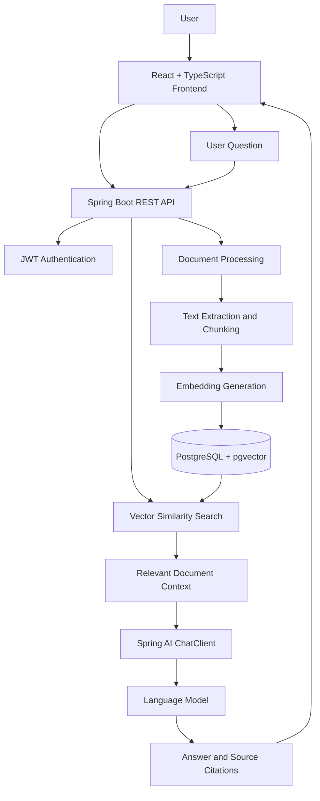

# DocMind — AI-Based Document Analysis System

An AI-powered document analysis and question-answering application that enables users to upload documents, search their contents, and receive context-aware answers using **Retrieval-Augmented Generation (RAG)**.

## Overview

DocMind combines a React frontend with a Java Spring Boot backend to provide an interactive document intelligence platform. It uses Spring AI, embeddings, and PostgreSQL with pgvector to retrieve relevant document passages and supply them to a language model when answering user questions.

The application also supports user authentication, document management, conversational interactions, source citations, and streaming AI responses.

## Features

- **Document Upload and Processing:** Upload supported documents and extract their content for analysis.
- **RAG-Based Question Answering:** Ask natural-language questions about document contents and receive context-aware AI-generated responses.
- **Semantic Search:** Retrieve relevant document chunks using vector embeddings and similarity search.
- **Source Citations:** Associate answers with retrieved document passages and source metadata.
- **Conversational Chat:** Maintain conversations and interact with documents through a chat interface.
- **Streaming Responses:** Receive generated answers incrementally using Server-Sent Events (SSE).
- **Authentication:** User registration, login, and JWT-based authentication.
- **Document Management:** View uploaded documents and inspect document chunks and search results.
- **Responsive Web Interface:** React-based interface with dedicated authentication, chat, search, and document views.

## Tech Stack

| Component | Technologies |
|---|---|
| Frontend | React 19, TypeScript, Vite |
| UI and State | Tailwind CSS, Zustand, React Router |
| Backend | Java 21, Spring Boot, Spring MVC |
| AI Integration | Spring AI, OpenAI model integration |
| RAG and Retrieval | Embeddings, vector similarity search |
| Database | PostgreSQL, pgvector |
| Persistence | Spring Data JPA, Hibernate |
| Security | Spring Security, JWT |
| Document Processing | Apache Tika, PDF document reader |
| API Documentation | Springdoc OpenAPI / Swagger UI |
| Build Tools | Maven, npm |
| Database Development | Docker Compose |

## System Architecture

The application follows a frontend-backend architecture with a retrieval-augmented generation pipeline.



### How It Works

**1. Document Ingestion**

- A user uploads a document through the frontend.
- The backend extracts document text using document-reading libraries.
- The extracted content is split into smaller chunks.
- Embeddings are generated for the chunks and stored through the configured vector store.
- Document metadata and processing status are maintained by the backend.

**2. Retrieval-Augmented Generation**

- The user submits a natural-language question.
- The backend searches the vector store for semantically relevant document chunks.
- Retrieved passages are assembled into context for the language model.
- Spring AI coordinates the model request through `ChatClient`.
- The generated answer and associated citations are returned to the frontend.

**3. Authentication and API Access**

- Users register and authenticate through backend API endpoints.
- JWT-based authentication protects secured API routes.
- Document access and retrieval should be scoped to the authenticated user to prevent cross-user data exposure.

**4. Streaming Responses**

The application includes a reactive streaming workflow that delivers generated response content incrementally using `Flux` and Server-Sent Events.

## Project Structure

```text
AI-docs-analysis-system/
├── src/
│   └── main/
│       ├── java/com/substring/docmind/
│       │   ├── config/          # Security, JWT, application configuration
│       │   ├── controller/      # REST API controllers
│       │   ├── dto/             # Request and response objects
│       │   ├── entity/          # JPA entities
│       │   ├── repository/      # Database access
│       │   └── service/         # Business logic and RAG pipeline
│       └── resources/           # Application configuration
├── frontend/
│   └── docmind-frontend/
│       └── src/
│           ├── components/      # Chat, upload, search, and UI components
│           ├── pages/           # Login and registration
│           ├── services/        # API integration
│           ├── store/            # Zustand state stores
│           └── types/            # TypeScript types
├── docs/                         # Architecture and implementation notes
├── docker-compose.yml            # PostgreSQL + pgvector
├── init.sql                      # Database initialization
├── pom.xml                       # Maven configuration
└── mvnw.cmd                      # Maven wrapper for Windows
```

## Getting Started

### Prerequisites

Install the following before running the application:

- Java Development Kit (JDK) 21
- Node.js and npm
- Docker Desktop with Docker Compose
- An OpenAI API key
- Git

### 1. Clone the Repository

```bash
git clone https://github.com/Harshgpt2006/AI-docs-analysis-system.git
cd AI-docs-analysis-system
```

### 2. Start PostgreSQL with pgvector

From the project root, run:

```bash
docker compose up -d postgres
```

The provided Compose configuration exposes PostgreSQL on port `5434` on the host and uses database `docmind`.

Verify that the database container is running:

```bash
docker compose ps
```

### 3. Configure the Backend

Review the backend configuration files and configure the database connection, OpenAI API key, JWT signing secret, and any other required application properties.

Use environment variables or a local, untracked configuration file for secrets. Never commit API keys, database passwords, or JWT signing secrets.

The database connection must use the host port and credentials configured for your environment. When running the backend outside Docker, the provided Compose configuration maps PostgreSQL to `localhost:5434`.

### 4. Run the Backend

From the project root on Windows:

```powershell
.\mvnw.cmd spring-boot:run
```

The backend uses Java 21 and Maven. Ensure that all required application properties are configured before starting it.

### 5. Run the Frontend

Open another terminal:

```bash
cd frontend/docmind-frontend
npm install
npm run dev
```

Open the local URL printed by Vite in your terminal.

### 6. Build the Frontend

To verify
